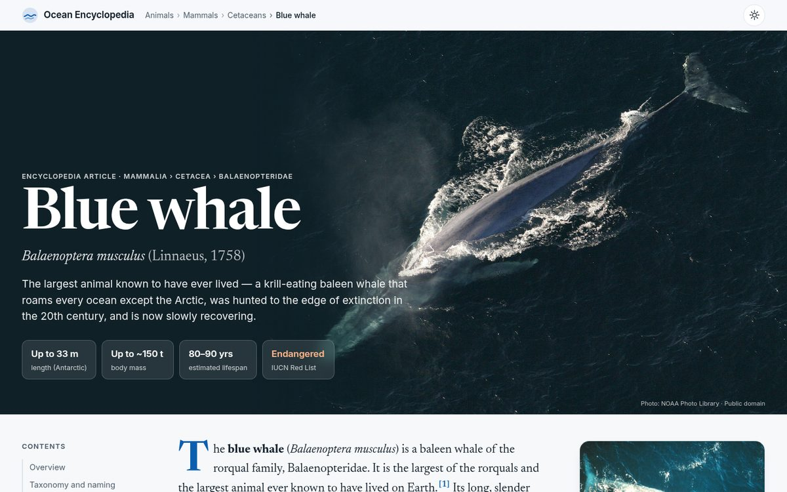
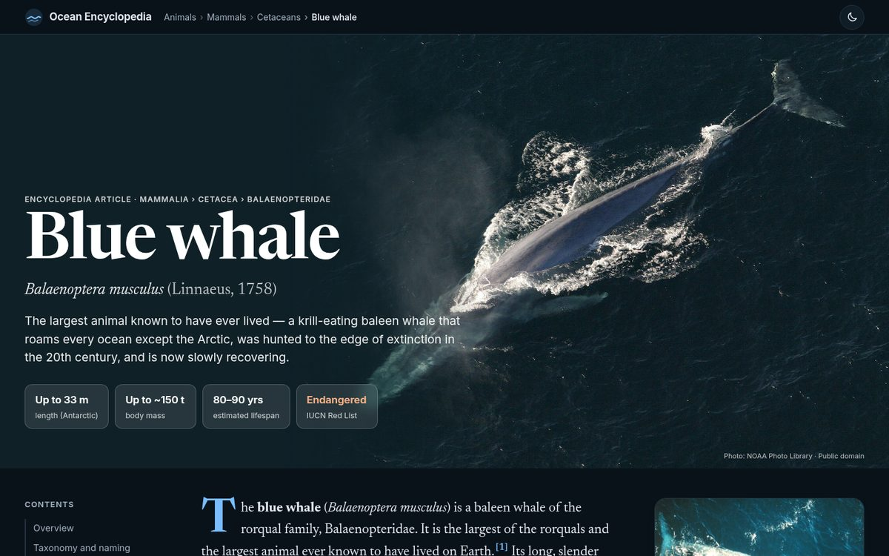
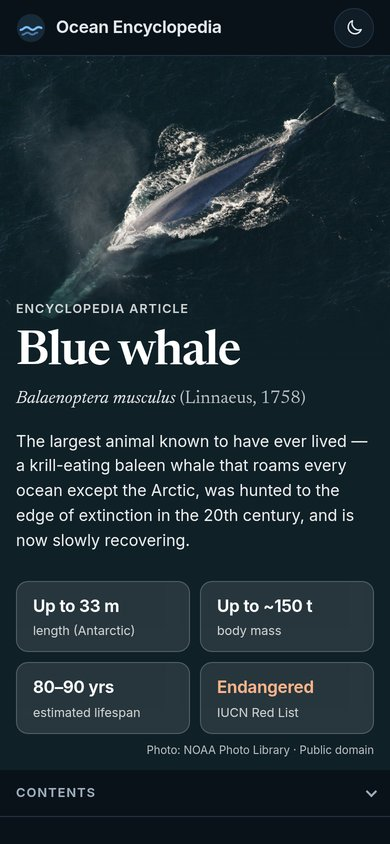
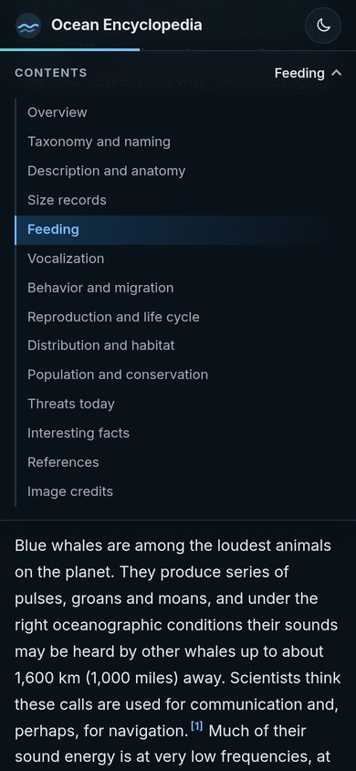

# Blue whale — Ocean Encyclopedia

A single-page, encyclopedia-style article about the blue whale (*Balaenoptera musculus*).
Plain HTML, CSS and JavaScript with no build step and no external requests: fonts and images are self-hosted.

> **Made entirely with Grok Bot.** This site was built end to end by Grok Bot, an AI assistant, as a test of its capabilities: research, writing, design, code, image sourcing and licensing, and screenshots.

**Live:** [blue-whale-site.onrender.com](https://blue-whale-site.onrender.com) (free Render static site)

## Preview

| Desktop, light | Desktop, dark |
|---|---|
|  |  |

| Mobile, dark | Mobile, table of contents |
|---|---|
|  |  |

**Demo video:** [watch the 84-second demo](https://blue-whale-site.onrender.com/docs/demo.mp4) (file: [docs/demo.mp4](docs/demo.mp4))

## Run locally

    cd blue-whale-site
    python3 -m http.server 8765
    # open http://localhost:8765

## Structure

    index.html            article markup and content (18 cited references)
    assets/css/style.css  design tokens, layout, light/dark theme (CSS light-dark())
    assets/js/app.js      theme toggle, reading progress, TOC scroll-spy, reference previews
    assets/img/           images downloaded from Wikimedia Commons (credits below)
    assets/fonts/         Inter and Newsreader variable fonts (SIL OFL 1.1, licenses included)
    docs/                 README preview images and demo video

## Image credits

| File | Author | License | Source |
|---|---|---|---|
| hero-blue-whale-aerial.jpg | NOAA Photo Library (anim1754) | Public domain (US Gov / NOAA) | https://commons.wikimedia.org/wiki/File:Anim1754_-_Flickr_-_NOAA_Photo_Library.jpg |
| blue-whale-eastern-pacific.jpg | NMFS Northeast Fisheries Science Center (NOAA) | Public domain | https://commons.wikimedia.org/wiki/File:Bluewhale877.jpg |
| size-comparison.png | Kurzon | CC BY-SA 3.0 (rendered from SVG) | https://commons.wikimedia.org/wiki/File:Blue_whale_size.svg |
| skeleton-pisa.jpg | Federigo Federighi | CC BY-SA 4.0 | https://commons.wikimedia.org/wiki/File:Balaenoptera_musculus_skeleton_at_University_of_Pisa%27s_Natural_History_Museum.jpg |
| fluke-morro-bay.jpg | Mike Baird | CC BY 2.0 | https://commons.wikimedia.org/wiki/File:Blue_whale_tail.JPG |
| range-map.png | Pcb21 (after Vardion) | CC BY-SA 3.0 (relicensed from GFDL); colors adjusted, and the adjusted file is shared under the same license | https://commons.wikimedia.org/wiki/File:Cetacea_range_map_Blue_Whale.PNG |
| aerial-southern-california.jpg | Don Ramey Logan | CC BY-SA 3.0 | https://commons.wikimedia.org/wiki/File:Large_Blue_Whale_Off_Southern_California_Coast_Photo_Don_Ramey_Logan.jpg |

All photos were resized and recompressed for the web; apart from the range map's colors, nothing else was changed.
